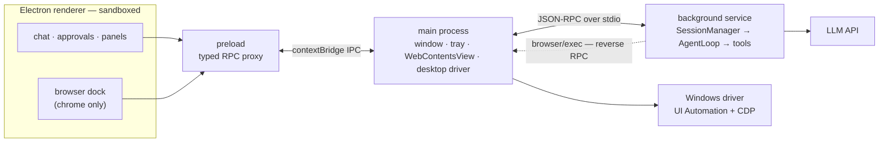
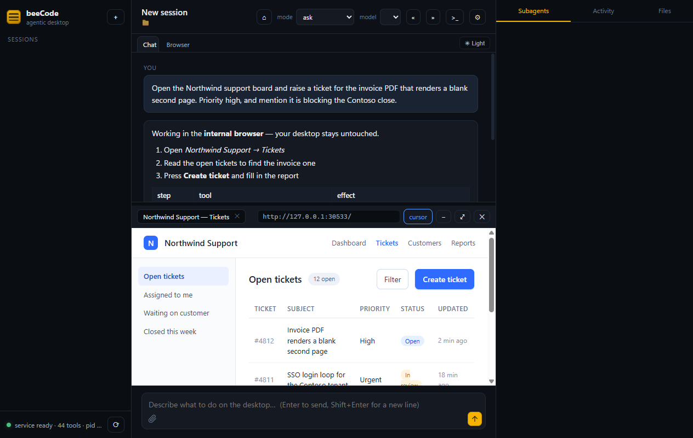
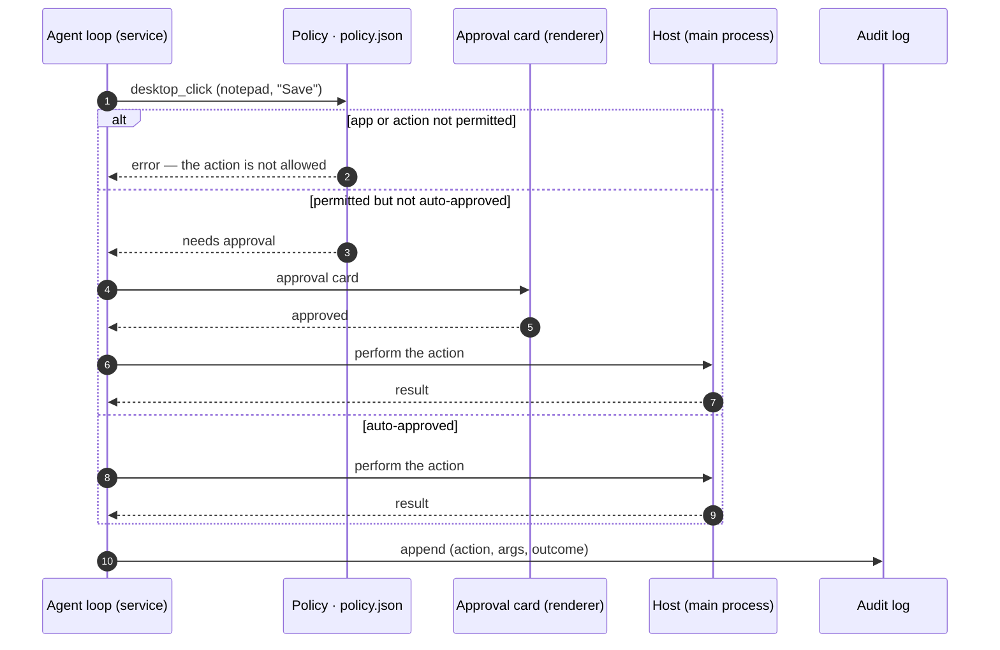
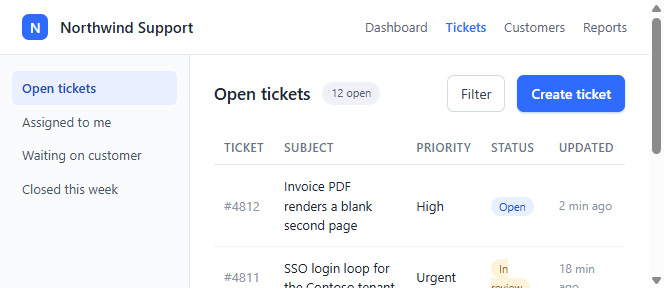
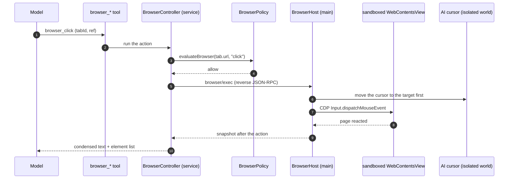

# beeCode

An agentic desktop application. beeCode watches and drives real applications on your
desktop — but only the ones you permit — and delegates work to subagents when a task is
better split up.

It is built on the architecture of [ado-code](../ado-code) (the Azure DevOps assistant for
VS Code): the same tool-calling loop, the same `{ "error": ... }` tool-result convention,
the same "ask / plan / act / autonomous" modes and the same adapter approach to external
agents. What is new is the host: instead of a VS Code extension it is an Electron desktop
app wrapped around a **background agent service** and a **permissioned desktop-control
layer**.





The arrow is not one-way. The internal browser’s page lives in the main process, so
when the agent drives it the service sends `browser/exec` *back* over the same stdio
pipe and main answers. Policy and audit stay in the service; the sandboxed
`WebContentsView` and the AI cursor stay on the host side.

## Quick start

```bash
npm install          # Electron is the only binary dependency
npm run build
npm start            # builds, then opens the app
```

Set a model key before the first prompt (keys are read from the environment and never
written to disk):

```bash
set ANTHROPIC_API_KEY=sk-...      # or OPENAI_API_KEY
```

Local models work too — add an `openai-compatible` preset pointing at Ollama or LM Studio
in the **Settings** panel (see below) or in `~/.beecode/config.json`.

## Extending it

Three extension points sit beside the built-in tools:

- **Plugins** — bundled starters plus any folder you drop into `~/.beecode/plugins/`: a
  `plugin.json` manifest and a CommonJS module, no build step. A plugin adds tools and
  reaches the outside world only through the permissions its manifest declares. Three ship
  with the app — a PDF viewer (`pdf_open`), a Markdown/HTML → PDF generator
  (`pdf_generate`) and an Excel exporter (`excel_export`) — and every plugin can be
  enabled or disabled in the **Plugins** card of the **MCP & skills** panel.
- **MCP servers** — point `mcpServers` in `~/.beecode/config.json` at any Model Context
  Protocol server (stdio or streamable HTTP); its tools appear as `mcp__<server>__<tool>`
  and go through the approval card unless the server marks them read-only. Servers can also
  be added, edited, enabled and removed in the **MCP & skills** panel.
- **Skills** — drop a `SKILL.md` playbook into `~/.beecode/skills/<name>/` (or
  `.beecode/skills/` in the workspace). The agent sees its name and description, and loads
  the instructions with the `skill` tool only when the task matches.

See [docs/plugins.md](docs/plugins.md) for the plugin contract, permissions and host
methods, and [docs/mcp-and-skills.md](docs/mcp-and-skills.md) for the MCP and skill config
shape.

## Settings

The **Settings** panel (right-hand sidebar, last tab) is where the endpoint, the model and
the working directory are chosen — no file editing required.

| Control | Effect |
| --- | --- |
| Provider · Model · Base URL · API key env var · Context window | one card per preset; **Base URL** is what points beeCode at a custom gateway (DeepSeek, OpenRouter, vLLM, Ollama, LM Studio) |
| **API key** (write-only) | paste the key to store it in `~/.beecode/secrets.json`; a blank field keeps the stored key, and the card shows whether one is set |
| `default` radio | the preset a new session starts with |
| Add model / Remove | extra presets; the service refuses a save that would leave none |
| Working directory + Browse… | where new sessions start and the boundary the file tools cannot leave |

Saving goes through `config.set`, so the service — not the renderer — decides what is
acceptable: ids are trimmed and de-duplicated, a trailing slash is stripped from the Base
URL, a dangling `defaultModelId` is repointed at the first preset, a blank working
directory falls back to the default, and a config with no usable preset is rejected. The
working directory is pushed into the policy engine as the filesystem root and created if it
does not exist. Existing sessions keep the directory they were created with.

### Where the key lives

`~/.beecode/config.json` is shareable user state, so a key is never written there. Three
ways to provide one, highest precedence first:

1. **Settings › API key** — write-only. The service moves it to `~/.beecode/secrets.json`
   (mode 0600) and `config.get` returns only a `hasKey` flag, never the value.
2. **`API_KEY=` in `.env.llm`** — read from the working directory or `~/.beecode/.env.llm`
   and published as `$BEECODE_LLM_API_KEY`.
3. **The env var named in "API key env var"** — e.g. `OPENAI_API_KEY`.

`apiKeyEnv` must be a variable *name*. A key pasted into that field is refused on save (and
dropped when an older config is loaded), because it would both land in `config.json` and
resolve to nothing. A missing key is reported before the request goes out —
`Missing API key for "<preset>"` — rather than surfacing as a bare 401 from the endpoint.
A loopback Base URL (Ollama, LM Studio) may still run keyless.

## What it can do

| Capability | Tools |
| --- | --- |
| See the desktop | `desktop_list_windows`, `desktop_ui_tree`, `desktop_screenshot` |
| Start and focus apps | `desktop_launch`, `desktop_focus`, `desktop_close` |
| Drive a UI | `desktop_invoke`, `desktop_set_value`, `desktop_type`, `desktop_hotkey` |
| Work with files | `fs_list`, `fs_read`, `fs_write`, `fs_search` |
| Run allow-listed commands | `shell_run` |
| Browse the web (sandboxed, AI cursor) | `browser_open`, `browser_snapshot`, `browser_click`, `browser_type`, `browser_key`, `browser_scroll`, `browser_wait`, `browser_tabs`, `browser_screenshot`, `browser_close` |
| Delegate | `subagent_delegate`, `agents_list`, `subagent_list`, `subagent_cancel` |
| Remember | `todo_write` / `todo_read`, `memory_write` / `memory_read`, `ask_user` |

Every one of those is gated. See [docs/desktop-permissions.md](docs/desktop-permissions.md)
for the policy, and [docs/windows-driver.md](docs/windows-driver.md) for how the driver
executes an action on Windows.

## The permission model (deny by default)



The agent can only touch applications listed in the policy, and only the actions ticked
for each one. This is enforced in the service — **not** in the prompt — so a clever prompt
cannot widen it:

```jsonc
{
  "id": "notepad",
  "name": "Notepad",
  "exe": ["notepad.exe"],
  "actions": ["launch", "focus", "read", "invoke", "type", "key", "screenshot", "close"],
  "autoApprove": true          // skip the confirmation prompt (still audited)
}
```

* `cmd.exe`, `powershell.exe`, `regedit.exe`, … are on a permanent deny list.
* Actions on an app rule without the action fail with a policy error the model can read.
* Mutating actions raise an **approval card** in the UI unless the app/action is
  auto-approved or the session is `autonomous`.
* Every allowed, denied, approved and failed action is appended to
  `~/.beecode/audit.jsonl` and mirrored in the **Activity** panel.

Edit the policy in the app (Permissions panel) or at `~/.beecode/policy.json`.

## The internal browser





The agent can browse the web in a window it drives itself, with a cursor you can watch
work. It is deliberately a *separate* surface from the desktop driver: nothing here
reaches your OS, your files or another app.

- The page is a sandboxed `WebContentsView` (`sandbox: true`, no Node,
  `contextIsolation`) in a dedicated, in-memory session. Every permission request,
  download, popup and non-web scheme is refused by the host before the page sees it.
- Input is dispatched through the DevTools protocol (`Input.dispatchMouseEvent` /
  `insertText` / `dispatchKeyEvent`), not scripted into the page, so a site cannot
  observe or fake what the agent clicked.
- The AI cursor is drawn in the page’s isolated world: it glides to the target, rings
  it and ripples on click, so you can follow along.
- Minimize, maximize and close live in the dock’s title bar. Minimizing collapses it to
  the tab strip and reports no rectangle, so the page view detaches instead of floating
  over the chat; maximizing fills the column above the composer; closing tears the tabs
  down rather than only hiding them. If the agent acts while the panel is minimized, it
  restores itself — a hidden page would hide the cursor you are meant to watch.
- Every call is audited under the `browser` action, and `browser_open` and friends are
  gated like any other capability.

It ships enabled and permissive because the sandbox — not a host list — is the boundary.
Tighten it in the policy document (`policy.json`):

```json
{
  "browser": {
    "enabled": true,          // false: every browser_* tool refuses
    "allowAnyHost": false,    // false: only allowedHosts are reachable
    "allowedHosts": ["github.com", "*.mozilla.org"],
    "deniedHosts": ["*.bank.example"],   // beats a wildcard
    "allowInput": false,      // read-only browsing
    "requireApproval": true   // ask before each navigation
  }
}
```

`file:`, `javascript:` and `data:` URLs are refused regardless of the lists, and
`about:blank` is always allowed so the agent can start from an empty tab. Host matching
is label-aware: `*.github.com` covers the apex and its subdomains, but not
`evil-github.com`.

Tab count, home page and session persistence live in `config.json` under `browser`
(`maxTabs`, `homeUrl`, `persistSession`, `showCursor`, `allowScripts`).

## Modes

| Mode | Behaviour |
| --- | --- |
| `ask` | read-only inspection; every mutation asks first |
| `plan` | no side effects at all — mutating tools are refused before approval |
| `act` | supervised execution; policy decides what needs a prompt |
| `autonomous` | no prompts, still fully bounded by the policy |

## Subagents

`subagent_delegate` hands a self-contained task to:

* **internal** — a nested beeCode session with a read-only toolset (files + windows +
  screenshots), useful for parallel research or verification.
* **CLI agents** — `codex`, `claude`, `gemini`, `aider`… spawned in the workspace when the
  binary is on `PATH`. Each is a config entry, not a class.

Runs are capped by `subagents.maxConcurrent`, streamed into the **Subagents** panel and
cancellable. Delegation depth is limited to 2 and a subagent cannot delegate further.

## Headless use

The same service runs without Electron, over loopback HTTP + SSE with a bearer token:

```bash
npm run service:http                     # prints { type, port, token } on stdout
curl -H "Authorization: Bearer <token>" \
     -d '{"jsonrpc":"2.0","id":1,"method":"tools.list","params":{}}' \
     http://127.0.0.1:4870/rpc
```

See [docs/service-protocol.md](docs/service-protocol.md).

## Project layout

```
src/
  main/      Electron main process: window, tray, IPC surface, service supervisor
  preload/   contextBridge API (the renderer's only capability)
  renderer/  the UI — plain TypeScript + CSS, no framework
  service/   the background agent service (never imported by the UI)
    llm/         provider-agnostic streaming client + system prompts
    session/     agent loop, session manager, approval handshake
    tools/       tool catalogue (desktop, files, shell, control, subagents)
    desktop/     driver interface, Windows PowerShell/UIA driver, mock driver, controller
    subagents/   runner + CLI adapters
    transports/  stdio JSON-RPC and loopback HTTP/SSE
  plugins/   plugin contract, host (discovery + permissions) and bundled starters
  shared/    protocol types, policy/config shapes, defaults, preload bridge contract
```

## Scripts

| Script | What it does |
| --- | --- |
| `npm run build` | esbuild bundles main / preload / service / renderer into `dist/` |
| `npm run typecheck` | `tsc --noEmit` (strict) |
| `npm test` | policy, desktop-controller and end-to-end service tests |
| `npm run smoke` | boots the real app in `--smoke` mode and asserts the UI reached the service |
| `npm run check` | typecheck + test + build + smoke |
| `npm run dist` | NSIS installer in `release/` via electron-builder |
| `npm run docs:screenshots` | boots the app, drives the internal browser and regenerates `docs/images/*.png` |
| `npm run verify:driver` | drives the real Windows driver against Calculator — UI Automation, coordinate clicks, resize |
| `npm run verify:llm` | round-trips the `.env.llm` endpoint through the agent loop |
| `npm run verify:installer` | boots the service out of the packaged `app.asar` and checks the shipped tools, driver and Settings panel |

## Status and limits

* The desktop driver is **Windows-only** (User32 + UI Automation through PowerShell). On
  other platforms the service falls back to the mock driver, so the app still runs and is
  testable; a native macOS/Linux driver can implement the same `DesktopDriver` interface.
* UI Automation is not available for every app (Electron/Chromium apps expose a reduced
  tree) — use `desktop_screenshot` with a vision model in that case.
* Sessions are in memory (bounded to 50); the durable record is the audit log, the
  workspace memory notes and `~/.beecode/config.json`.
