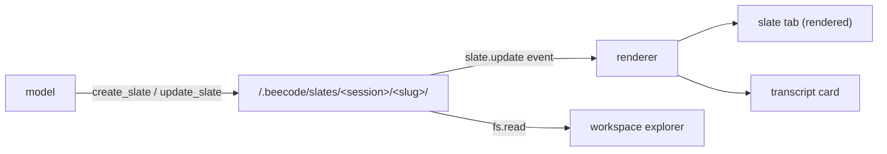

# Slates

> **Status: phases 1–3, Tier B (live slates and form submissions) and references-only recipes implemented** — the store,
> the four slate tools,
> the transcript card, the SLATE_TAB gallery, the Slates panel, promote, the document tab's
> Copy / Download / Preview ⇄ Code — and the same live host running *inside* the Preview of a
> slate tab, not only over the gallery pane — and the pipeline: a long fenced `html` / `svg` block is
> auto-promoted out of the transcript (`src/shared/slateFence.ts`, `src/service/slatePromote.ts`),
> a block that is still streaming reaches the gallery as `slate.delta` and is patched in place,
> and two versions can be compared (`src/shared/slateDiff.ts`, `slate.diff`,
> `src/renderer/slateDiffView.ts`). The store itself (/src/service/slates.ts), the three caps
> (*Size and retention caps*) and the promote form in both panes are in the tree too.
>
> **Tier B — live slates — is implemented**: a live slate runs in its own
> `WebContentsView` (`src/main/slate/host.ts`) on a per-slate *in-memory* partition with
> `sandbox: true` and **no preload**, so the page has no bridge to the app, no filesystem reach
> and no cookies that outlive the run. The document is served from memory over
> `slate://live/<session>/<id>/v<N>`, never from disk — main fetches it through `slate.read`, so
> the store's path guard stays the single source of truth — and the allowlist lands as a
> `content-security-policy` **response header**, not a meta tag the document could rewrite.
> Permission requests, downloads, popups, webviews, redirects and any navigation other than the
> exact hosted version are denied, and the `slate://` handler 404s every address that is not the
> version it is currently showing. The gallery tile carries the consent checkbox, the origins box
> and Run/Stop; the host reports what actually attached over `beecode:slate-live-state`, so the
> UI paints reality rather than the click. Giving an allowlist is still the user's answer alone:
> the agent may propose origins at creation (the approval card prints them) and cannot widen them
> afterwards. A slate without consent is refused with a message instead of a blank rectangle, and
> the live view only exists while the gallery pane is the view on screen. What remains
> proposal-only is called out per section below.

A **slate** is a self-contained document the agent generates inside a conversation and
beeCode renders **in the app** — in its own tab, next to the chat, instead of as a wall of
fenced Markdown in the transcript. The transcript keeps a small card that points at the
current version; the document itself lives in a tab you can re-read, version and keep.

The feature is deliberately narrow: a slate is *one document with a rendered view*, not a
notebook, not a bundler, not a live-coding surface. Everything about it is a workspace
file, so it can be read, diffed and deleted with the tools that already exist.



## Lexicon

One noun, used at every level — that is why this name was chosen.

| Level | Name |
| --- | --- |
| Collection, tab, RPC namespace, folder | **Slates** — `SLATE_TAB`, `slate.*`, `.beecode/slates/` |
| One generated document | **slate** — a count noun: "open the slate", "3 slates", "delete this slate" |
| Types | `Slate`, `SlateSummary` |
| Tools | `create_slate`, `update_slate` |
| Event | `slate.update` |
| Tool group | `'slate'` |
| Module names | `src/service/slates/store.ts`, `src/service/tools/slates.ts`, `src/renderer/slateGallery.ts` |

Naming constraints this satisfies, taken from what the repo already does: RPC keys are
`noun.verb` with a single lowercase namespace (`plugin.list`, `skill.read`,
`knowledge.remove`), tool names are `verb_noun`, and the module for the viewer is
`slateGallery.ts` rather than `slate.ts` so it does not read as the feature noun itself:
individual slate documents reuse `mountFileView`, only the gallery is new code.

**Residual naming risk:** Slate.js is a well-known rich-text editor framework. Never add
`slate.editor` / `slate.rich`, and open every tool description with the plain gloss:

> Slate — a self-contained document generated in this session and rendered in-app
> (`markdown`, `html`). Not a rich-text editor.

## The document tab is inert — say so, do not go blank

A slate opens as an ordinary document tab, and its rendered view is the app's own
`htmlPreviewMarkup` (`src/renderer/preview.ts`): `<script>` blocks, `on…=` handlers and
scripting URLs are stripped, so nothing in a slate can run from the tab. An html slate that
builds its own DOM in JavaScript — a mini-app, the common case — therefore leaves an empty
mount point behind, and the pane used to be blank with no explanation.

The preview explains itself instead: `sanitizeHtmlReport` counts the script blocks and
handlers it dropped, and `htmlPreviewNotice` turns that into a `.preview-notice` banner above
the document that says the page is script-driven and points at the live view. A page with no
scripting carries no banner.

## Preview runs the live page — a slate tab is not a dead end

A slate version shown as **Preview** is the one document that also gets Tier B, in place.
`docLiveBar` (`src/renderer/mainArea.ts`) sits between the tab's head and its body, and the
body underneath is the rectangle the sandboxed page covers once it runs. The same bar is
offered for a plain workspace `.html` file — see the next section.

* The bar is the *same* grant the tile in the Slates tab asks for — **Allow scripts (live)**,
  the origins it may fetch from, and Run/Stop — because a live page is the same grant wherever
  it is started from. `SlateGalleryHandlers` grew an optional `sessionId` so a document tab
  names the session it belongs to instead of the chat that happens to be on screen.
* The inert preview stays underneath the whole time. If the host refuses, `liveView.error` is
  printed in the bar and the tab keeps showing what it can without scripts, so a refusal can
  never leave a blank pane again.
* `slateDocLiveTarget` (`src/renderer/slateDocLive.ts`) decides *when* the bar exists at all:
  an html version, the Preview view, a slate of the session on screen, and a summary the
  renderer actually holds — the consent and the origins live in it. Code view, markdown and a
  tab from another session keep the inert preview with no bar.
* `docLiveHoldsLive` matches session, slate **and version**: the host runs one page at a time,
  so switching that tab to Code, closing it or opening another version takes the page down
  (`liveOnScreen()` in `src/renderer/main.ts`) instead of leaving it floating over the chat.
* The rectangle is not automatic — a native view does not reflow. `renderDoc` publishes it
  through `liveStageSync` on every render, and one `ResizeObserver` on the pane plus `resize`
  keep the page on the body while the dock or a panel moves it.
* **A slate that reaches nothing is still live.** The host used to refuse a slate with no
  origins and no form ("nothing it may do"), which made the self-contained interactive page —
  the kind that most needs its scripts — the only kind that could not run. What it may reach is
  the CSP baked into the response, so an empty allowlist means the code runs and every
  connection is refused.

## A plain workspace file gets the same page

The live host is not slate-only. A workspace `.html` file opened in a document tab gets the
same bar and the same sandbox, because it has exactly the same failure mode: the page is built
by its own script and the inert preview strips it.

* `fileDocLiveTarget` (`src/renderer/slateDocLive.ts`) offers it for a `.html`/`.htm` file in
  the Preview view whose text the tab already holds — and never for a slate version, which has
  its own target because it also has a store to remember consent in.
* The page is served from memory over `slate://live/file/<hash>/v1`, never from its folder:
  `showFile` hands the *text* to the host and the id is a hash of path and bytes, so the URL
  names no folder and an edited file is a different page. The consequence is honest and stated
  in the bar — a page loading a sibling `style.css`, `app.js` or an image looks unstyled or
  half-built here, while a browser shows it finished.
* **One click, not two.** A slate's consent lives in the store, so it is ticked once and
  re-checked on every run; a file's grant lives only as long as the run, so the Run button *is*
  the grant and there is no consent switch. A repaint therefore never loses a tick, and a
  running page never has to be stopped to be granted again.
* `docLiveHoldsLive` compares the path the host reports (`live.filePath`) with the tab's, so
  switching that tab to Code, closing it, or re-running an edited file takes the page down
  instead of leaving it floating over the chat.
* `SLATE_LIVE_LIMITS.textBytes` (4 MB) is the ceiling: above it the bar is not offered at all,
  because a Run button whose only outcome is a refusal is worse than none.

## The scheme is registered on the view's own session — nowhere else

`serveSlateLive()` used to call `protocol.handle(SLATE_LIVE_SCHEME, …)` from the
`electron` module, which registers on the **default** session only. But `harden()` gives
every live view its own in-memory partition (`session.fromPartition`, no cache),
so the page that loaded `slate://…` had no handler for that scheme at all: Chromium
aborted the navigation with `ERR_FAILED (-2)`, the orchestrator reported a live page that
"did not attach", and every script-built slate stayed empty in the app while testing fine
in a browser.

Two rules follow, and both are load-bearing:

* **Register the scheme on the session that loads it** — `ses.protocol.handle(…)` inside
  `harden()`, the one place the partition is created. A registration on the default
  session is never consulted by a partitioned view, whatever the URL says.
* **Gate on the settled load, not the optimistic state.** `show()` publishes
  `{ visible: true }` before it awaits `loadURL`, so a smoke assertion that waits for
  `visible` passes while the failure is still in flight. `scripts/smoke.mjs` now waits for
  the load to settle and requires `loadError === ''`, recording the whole state sequence
  when it does not.

## Non-goals

| Not in scope | Why |
| --- | --- |
| A dev server, bundler or npm dependencies per slate | Slates are single files with no build step |
| React/JSX slates | Needs a bundler; unless it ships as a self-contained bundle, it stays out (see Tier C) |
| A second storage layer | Everything reads back through `fs.read` |
| Artifacts outside the workspace | App-data storage makes them invisible to the user and to `git` |
| Multi-file slates | One slate, one file, one purpose |

## Storage and versioning

```
<cwd>/.beecode/slates/<sessionId>/<slug>/
  meta.json        { id, title, kind, current: 3, versions: [...], createdAt, updatedAt,
                     recipe? }
  001-<slug>.md
  002-<slug>.md
  003-<slug>.md
```

`recipe` is optional: it records the tool calls that produced a version, which is what
makes a snapshot refreshable while the document itself never holds a connection
(see *Data sources*).

* Every write appends an **immutable** file; `meta.current` is the pointer. `update_slate`
  never overwrites, so "make the bars green" costs one small file, not a second copy of a
  400-line document in the transcript.
* `slug()` and the `rm`-on-remove behaviour follow `src/service/skills/store.ts`, whose
  project root is likewise `<cwd>/.beecode/skills`.
* The path guard rejects `..` and absolute paths before any write — a slate id from the
  model is untrusted input.
* **Dropped from v1 — `.git/info/exclude` seeding.** An earlier draft appended `.beecode/`
  to the workspace's `.git/info/exclude` so generated files never reached `git status`.
  Dropped deliberately: writing inside `.git/` mutates version-control internals the user
  never approved, it surprises in worktrees and submodules, and it stops being necessary once
  *promote* exists. v1 leaves `git status` alone and documents `.beecode/slates/` as
  ignorable; if this returns it is an explicit settings action, never a side effect of
  `create_slate`.
* `.beecode/` is already skipped by recursive `fs.search`, so slates never pollute search
  results — no change needed there.
* **Promote to project** writes the current version into the real tree, for when the user
  actually wants to keep the document. The slate folder stays the source of truth until
  then.

### Identity — id, slug, and an immutable kind

* **`id` is the slug.** The folder name *is* the identifier
  (`<cwd>/.beecode/slates/<sessionId>/<slug>/`), derived from the title with the same
  `slug()` shape the skills store already uses (`src/service/skills/store.ts:224`). A
  collision inside the session appends `-2`, `-3`. No second, opaque id exists that could
  drift away from the folder.
* **The id is immutable.** Renaming a slate changes `meta.title` only; the folder does not
  move, because every `DocTab` and every tool result already refers to the path.
* **`update_slate` accepts a strict id shape** — `^[a-z0-9][a-z0-9-]*$` — no dots, no
  extension, no separators, no absolute path, and the resolved folder must stay under
  `<cwd>/.beecode/slates/<sessionId>/` (*Policy interaction* holds the guard).
* **`kind` is fixed at creation.** The version file's extension is derived from it
  (`NNN-<slug>.md|.html|.csv`) and `viewerKind()` dispatches per file, so a folder holding
  mixed extensions would render differently version to version and break pinning.
  `update_slate` therefore takes no `kind` argument; changing kind means a new slate.
* **v1 kinds are `markdown`, `html`, `csv`.** Markdown carries `chart` code fences
  (`src/renderer/chart.ts`); CSV renders in `csv.ts`. `svg` and `log` are phase 2 at the
  earliest. Mermaid is out — there is no renderer for it in `src/`.

### Size and retention caps

Refusals, never silent truncation: an over-limit write returns `{ error: ... }` like any
other tool failure, because a silently truncated document is worse than a rejected edit.
The numbers are one constant — `SLATE_LIMITS` in `src/shared/protocol.ts` — enforced in
`src/service/slates.ts` (`assertSize`, `update`, `create`), so the renderer can never show
a limit the store does not refuse on. `slate.remove { version }` drops one version file and
is the escape hatch the table names; the panel and the gallery still remove whole slates,
because deleting one version of a document someone is reading belongs beside the version
picker rather than behind a click that looks like the other one.

| Limit | Value | On breach |
| --- | --- | --- |
| One version | 2 MiB | `create_slate` / `update_slate` refuse |
| Versions per slate | 50 | refuse; `slate.remove { version }` drops one and unblocks |
| Slates per session | 100 | `create_slate` refuses |

The per-version cap follows the existing skills precedent, which skips oversized files
against `maxBytes` (`src/service/skills/store.ts:19`, `:149`). `slate.list` reports each
slate's byte size and version count, so the gallery can show pressure before a refusal.
Nothing is pruned automatically: a version a user pinned or promoted must not vanish
because a later edit crossed a threshold.

### Policy interaction — one exemption, one hard guard

This was blocking: the store writes with node `fs` directly, while `filesystem.writable`,
knowledge-folder protection and the workspace roots all live in `policy.evaluateFile`
(`src/service/policy.ts:249`). That function describes **user documents**. A slate is not
one. The decision:

| Rule | Rationale |
| --- | --- |
| Store reads and writes **skip** `evaluateFile` | The store only ever touches `<resolve(cwd)>/.beecode/slates/`, a directory it created itself. `filesystem.writable === false` means "do not modify my files"; it must not be read as "an agent may not draft a document on its own scratch pad" |
| The confinement guard **is** the control | `resolve()` the target and require it to stay inside the session's slate root; reject `..`, absolute ids and any id containing a separator; `realpath()` the root once per call so a symlinked slate folder cannot redirect writes outside the workspace. Immutable `NNN-<slug>` naming plus `meta.json` as the only mutable file makes collision with user data structurally impossible |
| `promote_slate` is **not** exempt | It writes into the real workspace tree, so it calls `evaluateFile(target, true, ctx.workspaceRoots)` and surfaces the result, including knowledge-folder denial and `requiresApproval` |
| `slate` **is** in `WORKSPACE_GROUPS` (`src/service/tools/registry.ts:10`) | Unrelated to writes: that set is the *no-cwd refusal* (`registry.ts:112`). A slate cannot exist without a working directory to put it in |
| No `slates.enabled` policy flag in v1 | A flag added before the feature exists is speculative config. The gallery tab, the tools and the delete action are the user's control surface |

Consequence to state in review: with file writes disabled, `create_slate` still works and
`promote_slate` fails with the policy reason. The asymmetry is intended and is covered by a
test (see *Testing*).

## Security model — the decision that matters

Agent-authored HTML must **never** be mounted into the renderer. The renderer is the
privileged, sandboxed-but-trusted UI process; injecting model output into it is an XSS
straight into the app. Rendering is therefore split into three tiers.

| Tier | Content | Host | Status |
| --- | --- | --- | --- |
| **A** | `markdown`, `html` | Existing renderer viewers — `src/renderer/preview.ts` (`sanitizeHtml`, `htmlPreviewMarkup`) and the Markdown renderer | v1 |
| **B** | HTML that genuinely needs scripts, self-contained JS | A dedicated `WebContentsView` with `sandbox: true`, `contextIsolation: true`, **no preload**, its own `persist:slates` session, and a strict CSP (`default-src 'none'; img-src data:; style-src 'unsafe-inline'`) | phase 2 |
| **C** | React / anything with a build step | — | out of scope |

Tier B reuses the browser-dock / `pluginHost` host pattern rather than inventing a second
one. "Rendered in-app" never means "with app privileges": the language in the UI (and in
the README) is *documents that render in-app, not in a browser tab or a download*.

`preview.ts` states the same principle for the existing preview: `sanitizeHtml` is defence
in depth, not the only guard, because the renderer document runs under a CSP without
`unsafe-inline` scripts. A slate adds no new privilege — it reuses those viewers.

## Protocol

Types and four keys in `src/shared/protocol.ts`, beside the existing `skill.*` /
`knowledge.*` entries (which is where the `{ params, result }` shape comes from):

```ts
// RpcRequests
'slate.list':    { params: { sessionId?: string }; result: { slates: SlateSummary[] } };
'slate.read':    { params: { id: string; version?: number }; result: Slate };
'slate.remove':  { params: { id: string }; result: { slates: SlateSummary[] } };
'slate.promote': { params: { id: string; path: string }; result: { path: string } };

// ServiceEvent
| { type: 'slate.update'; payload: SlateSummary }
```

`slate.update` is the **only** thing that repaints the UI. The renderer does not adopt
state from a mutation it did not make — the same lesson the `workspace.state` event
encodes, which is why the smoke probe must assert the tab renders after a *tool*-driven
create and not only after a renderer-initiated one.

Adding keys is additive; `PROTOCOL_VERSION` only moves on a breaking change.

The method list in `src/shared/bridge.ts` is enumerated by hand, so each new key must be
added there too or the preload proxy will refuse it.

## Tools

New group `'slate'`, registered in `buildToolRegistry()` in `src/service/tools/index.ts`
next to `skillTools(...)`:

```ts
create_slate { title, kind: 'markdown' | 'html' | 'csv', content, origins?, submit? }
update_slate { id, content, submit? }   // appends a version; kind is fixed
slate_submissions { id, since? }        // read-only: what a form posted back

`submit` declares the form a live `html` slate accepts (see *Form submissions — one
endpoint, one sink*). On `update_slate` it is carried forward when omitted and withdrawn
with `null`, the same shape `recipe` uses. `slate_submissions` is read-only and therefore
belongs in `SUBAGENT_TOOL_ALLOWLIST` if subagents ever get the slate group.
```

Both are `mutating: true`. `create_slate` returns the new id and version so the model can
follow up with `update_slate` instead of re-emitting the whole document through
`write_file`.

`'slate'` also joins `WORKSPACE_GROUPS` in `src/service/tools/registry.ts`. That set is
what *refuses* a tool when no workspace root is configured (resolving a relative path
against the process directory would silently make the install folder the agent's
workspace) — a store rooted at `<cwd>/.beecode/slates` depends on that guarantee.

`SUBAGENT_TOOL_ALLOWLIST` in `src/service/tools/index.ts` is an explicit **read-only**
list; `create_slate` / `update_slate` must not be added to it. Subagents get slates only
if a later decision explicitly opts them in.

### Approval behaviour — one card per slate, none for edits

Approval is decided by the tool's own `preview` / `mutating` flag, **not** by the policy
engine: `AgentLoop` sets `requiresApproval: tool.mutating` by default
(`src/service/session/AgentLoop.ts:335`) and raises the card at `:346`; plan mode refuses any
`mutating` tool before a prompt is shown (`:311`); `autoApproveTools` and autonomous mode
bypass the card.

| Tool | `mutating` | `preview().requiresApproval` | Result |
| --- | --- | --- | --- |
| `create_slate` | `true` | `true`, summary `Create slate "Sales Q3" (markdown)` | one card; *allow for session* silences later creates |
| `update_slate` | `true` | **`false`**, reason `appends v(N+1) to an app-owned slate; no user file is touched` | no card — otherwise every "make the bars green" prompts, which makes the feature unusable in chat |
| `promote_slate` | `true` | inherits the policy decision | card, because it writes a real file |

`mutating: true` stays on both write tools even though `update_slate` is pre-approved: plan
mode's read-only guarantee is expressed through `mutating`, so dropping it would let a
plan-mode session generate slates. Approval and mutability are separate axes and this doc
must not conflate them.

### Settings → Tools registration — three places, one free switch

`'slate'` joins a **closed union**, so it costs three registrations — and one of them
fails silently if forgotten:

| Place | Why |
| --- | --- |
| `ToolDefinition.group` union, `src/shared/tools.ts:37` | compile-time: the tool group does not typecheck without it |
| `TOOL_GROUP_ORDER`, `src/renderer/panels.ts:70` | the catalogue iterates this array, so a group missing here **never renders** — even when its tools exist and a label is defined |
| `TOOL_GROUP_LABELS: Record<ToolInfo['group'], string>`, `src/renderer/panels.ts:84` | exhaustive record: typecheck fails until a label is supplied |

**Per-tool switching needs no slate code.** `config.tools.disabled` is a list of tool
*names* (`src/service/service.ts:226`, applied through `registry.setDisabled` at `:843`),
and the Settings copy already states the contract — a switched-off tool is not offered to
the model and refuses to run if it is called anyway. Both slate tools therefore appear as
individual switches for free; no user has to opt in or out of the feature as a whole.

**No group-level kill switch in v1.** A slate is an additive tool call, not a surface that
keeps running — unlike the browser dock, it needs no "enabled" flag.

### Subagent visibility and session scoping

**Subagents get no slate access in v1** — neither write nor read. `SUBAGENT_TOOL_ALLOWLIST`
(`src/service/tools/index.ts:52`) is a deliberate read-only list and the slate tools stay
out of it. If a subagent needs document content, the parent inlines it in the prompt, which
is what already happens with any other file.

That follows from storage being session-scoped: the gallery lists the caller's
`<sessionId>`, and a subagent run has its own session, so a subagent-authored slate would
land in a folder no UI ever browses — an invisible orphan on disk.

Should subagent slates be enabled later, the rule is: the subagent writes into the
**parent's** session folder, passed explicitly, never its own; and `slate.list` still
returns only the caller's session. Cross-session listing is not v1 and should not be added
as a convenience — that is what would turn the gallery into a global file browser.

## Data sources

A slate is **author-time connected and render-time inert**. That is a contract, not an
omission: the agent fetches the data with its own tools and writes the result in as a
version; the document never reaches for a source itself.

### Render time — no connection, by construction

| Surface | Constraint |
| --- | --- |
| `markdown` / `html` (Tier A) | `src/renderer/index.html:7` sets `connect-src 'none'` with `script-src 'self'`, and `sanitizeHtml` strips scripts — there is neither code to call an API nor an origin allowed to |
| `svg` / image | loaded as an `` through `fileAssetUrl`, workspace-confined and inert |
| sandboxed `WebContentsView` (Tier B, phase 2) | the only surface where live JS could run; whether it reaches the network is its CSP, i.e. a per-slate decision rather than a default |

So "a slate that queries the database when you open it" is Tier B **plus** a consent and
audit model. It is not v1, and nothing in Tier A can be talked into it.

### Authoring time — what the agent can actually reach

| Source | Route | Status |
| --- | --- | --- |
| CSV / TSV / JSON / logs / Markdown | `fs_read` → `create_slate`; `.csv`/`.tsv` render through the existing `csv` viewer, aggregates via a `chart` code fence | ✅ works, no new code |
| **Spreadsheets (.xlsx)** | ⚠️ gap — `fs_read` is UTF-8 text only (`src/service/tools/files.ts:97`), so a workbook comes back as mojibake. `src/service/preview/office.ts` *can* parse one, but it is wired only into the attachment preview (`service.ts` `readOfficePreview`), not exposed as a tool | needs `shell_run`, an MCP server, or a small plugin |
| Databases | no native driver in `src/`. Via **MCP** — `protocol.ts:513`, external servers whose tools are exposed to the agent — so a Postgres/SQLite/MSSQL server hands the agent query tools; or `shell_run` with `psql`/`sqlcmd`/`sqlite3` where the shell policy allows it | ✅ works, configuration-dependent |
| Apps over HTTP | there is **no generic `http_fetch`** tool. Routes: `shell_run` (curl / `Invoke-WebRequest`), an MCP server for that app, or the `browser_*` tools when only a UI exists | ✅ works, indirect |
| Desktop apps | `desktop_*` (UI Automation) reads a native app's UI tree and values | ✅ works |
| Plugins as connectors | ❌ `PLUGIN_PERMISSIONS` (`src/plugins/types.ts:21`) is `files:read`, `files:write`, `pdf:view`, `pdf:render` — no network or database permission exists, and user plugins load in-process (`src/plugins/host.ts:373` — `createRequire` + `require`; no `vm`, no worker, no `utilityProcess`), so that list bounds the API surface rather than a sandbox | do not build a datasource layer here |

### Snapshots, not dashboards

Slates are **versioned snapshots**. `update_slate` appending v4 *is* the refresh — good for
auditability and diffing, and it means a dashboard is stale the moment it is created. The
ways to live with that, cheapest first:

| Pattern | Cost | Phase |
| --- | --- | --- |
| Someone asks again ("update the sales slate") → v4 | free, human in the loop by default | 1 |
| `meta.json` stores the **recipe** and `refresh_slate` replays it | small, still explicit | 1.5 — implemented |
| `schedule` (`src/service/tools/scheduler.ts:63`) starts a fresh session with a prompt on a timer → one new version per run | prompt-shaped authoring; no dependency on the slate layer | 2 |
| The document subscribes to the source itself | Tier B + `connect-src` allowlist + per-slate consent + audit trail | 3 |

The **recipe field is the important one**: it turns "data source support" from a renderer
capability into a stored, replayable provenance record, so a snapshot can be refreshed
without the document ever holding credentials or a connection.

### Getting data back out

Both directions already exist as builtin plugins and need no slate work:
`pdf_generate` (`src/plugins/builtin/pdfGenerator.ts:28`) accepts `markdown` **or** `html`
content, and `excel_export` (`tableExport.ts:112`) accepts a `csv` string or a `.csv`/`.tsv`
path and writes a real `.xlsx` (bundled OOXML writer, no dependencies). A slug with a
*Download as PDF / XLSX* action therefore needs only the plugin call already registered.

### Form submissions — one endpoint, one sink

A live slate can already POST to an origin on its allowlist. It can also post **back to
the app**, which is what makes it usable as a form without running any server:

- **Endpoint.** `POST slate://live/<session>/<id>/v<N>/submit` — the URL the page was
  served from, one path deeper. Same origin, so there is no token, no port and no CSRF
  surface, and nothing else on the machine can reach it. `slateLiveCsp` adds `'self'` to
  `connect-src` **only** for a slate that declared a form; every other slate keeps
  `connect-src 'none'`. The scheme privilege `supportFetchAPI` is on for this reason.
- **Payload.** `{ submissionId, fields }`, capped at 64 KB. `form-action` stays `'none'`,
  so the page posts with `fetch` from a submit handler — which is also what keeps the
  target pinned to the version that rendered it: the host answers only for the version
  it is currently hosting.
- **Schema.** The form is declared where the origins are — on the slate version
  (`version.submit`, normalised by `normaliseSlateSubmit` in `src/shared/slateSubmit.ts`).
  It is what the approval card prints ("may send form results back to the app") and what
  the sink validates with. A submission is checked against the schema of the version it
  came from, so updating the form cannot move the ground under a rendered page.
- **Sink.** `<slate folder>/submissions.jsonl`, append-only, one JSON object per line,
  capped at 200 per slate (a refusal, never a prune). A replayed `submissionId` returns
  the row that already exists instead of appending a second one.

The answer is `{ ok: true, n }` or `{ ok: false, errors: [{ field, message }] }` and
nothing else. It is deliberately **not** an RPC: the moment a page can name a method,
authored HTML becomes a client for every tool in the service and the "no preload,
therefore no bridge" argument inverts. Orchestration stays with the agent — the slate
renders, the user types, the sink records, the agent acts.

### Risks that remain in the live tier
1. **Exfiltration** — agent-authored JS with a network path can POST workspace content
   anywhere. Mitigation: a per-slate origin allowlist stored in `meta.json` and shown at
   approval time; never `connect-src *`.
2. **Credentials** — a slate that talks to a database needs a token, and it must never be
   baked into a version file. Route it through the service, never through the document.
3. **MCP trust boundary** — an MCP server's tools become agent-invocable in general, so
   adding one to reach a database widens what the agent can do everywhere, not just in slates.

## Export — a slate as a mini-app

A slate is already a document with an origin, so exporting it is not about copying an app:
it is about making that document meaningful where the app is not. Three layers, and only
the first travels.

| Layer | Travels | Why |
| --- | --- | --- |
| **Document** — `html`, `kind`, declared `origins`, `submit` schema, recipe refs | yes | it is a file plus a small sidecar |
| **Approval and origin allowlist** | no | it belongs to the machine that approved it; a shared app must never inherit the author's allowlist |
| **Submission sink** — the `slate://` route and `submissions.jsonl` | no | app-local state, next to the conversation that produced it |

### The bundle

| File | Contents |
| --- | --- |
| `index.html` | the version's html, byte for byte |
| `slate.json` | `{ slate: { id, version, kind }, origins, submit }` — the sidecar that makes the document mean something elsewhere |
| `slateSubmit.mjs` | optional: the compiled validator (`dist/host/slateSubmit.mjs`, built from `src/shared/slateSubmit.ts`) |

The sidecar is `meta.json` reduced to what a host needs:

```json
{
  "slate": { "id": "contact-intake", "version": 1, "kind": "html" },
  "origins": ["https://api.example.com"],
  "submit": { "fields": [{ "name": "email", "type": "text", "required": true }] }
}
```

`origins` is **declared intent**, not permission: it tells the host what the page wants to
reach, and the host (or its user) decides whether that is granted.

### The wire contract

One route, one payload, identical to the live host:

| | |
| --- | --- |
| Request | `POST <app base>/submit`, `content-type: application/json`, `{ submissionId, fields }`, 64 KB |
| Accepted | `200 { "ok": true, "n": 3 }` |
| Rejected | `400 { "ok": false, "errors": [{ "field": "email", "message": "this field is required" }] }` |
| Replayed | the same `submissionId` again returns the **existing** row instead of appending a second one |
| Never | anything beyond ok/errors — no method names, no state, no autocompletion of what the page may ask for |

The page keeps `fetch('submit', …)` **relative**. That single rule is why an export works:
nothing in the document names a host, so the same html runs under
`slate://live/<session>/<id>/v<N>/` and under `https://app.example.com/`. Absolute
`slate://` URLs, session ids or version numbers baked into a page are exactly what has to
be rewritten per host — so a slate that is meant to be shared must not contain them.

### What a host must implement

1. **Serve the document** with the slate CSP as a response header —
   `slateLiveCsp(origins, { submit: true })`. The CSP is set at serve time, not embedded in
   the html, so an exported page carries no containment with it: a host that omits the
   header silently loses every guarantee the live tier makes.
2. **Accept `POST /submit`** and refuse every other write. `form-action` stays `'none'`, so
   a page that relies on `<form action>` does nothing — that is the rule, not a bug.
3. **Validate with `validateSlateSubmission(schema, fields)`** — the same function, unchanged.
   It is pure (no Electron, no `fs`, no `slate://`), so it runs as-is in a Node server, a
   worker or an edge function. A second validator is a second set of bugs.
4. **Persist append-only**, unique on `(slateId, submissionId)`, with a ceiling that refuses
   rather than prunes.

### What a host must not implement

- **Submission as RPC.** If the page can name a method, authored html becomes a client for
  everything the host can do. One route, one shape.
- **Inherited trust.** A shared app is re-approved where it runs; `origins` travels as a
  declaration, never as a grant.
- **A public read endpoint.** Submissions are the owner's data: gate reads behind a token or
  leave them to the agent (`slate_submissions`).

### The prototype

`scripts/slate-host/mini-app-host.mjs` is a reference host: it serves the bundle, publishes
`slateLiveCsp`, validates with the app's own compiled validator, and persists to **SQLite**
via `node:sqlite` — a Node builtin, so still no dependency — or to JSONL with
`--sink=jsonl` (a Node build without `node:sqlite` says so and falls back).

```
npm run build                                                                    # dist/host/*
node scripts/slate-host/mini-app-host.mjs scripts/slate-host/example --sink=sqlite
```

It binds `127.0.0.1` only (there is no `--host` flag on purpose), requires
`content-type: application/json` — a cross-site html form posts urlencoded, so that alone
blocks the classic CSRF shape — rejects a foreign `Origin`, and exposes
`GET /submissions` only when a `--token` is configured. Reads come back as
`{ n, id, at, version, fields }` under either sink: the storage shape (a row, or a jsonl line
carrying `slateId`/`submissionId`) is the sink's own business, never the route's.

SQLite appears **here** because a hosted app is a different artifact from an in-app slate.
The app's own sink stays `submissions.jsonl`: append-only, diffable, and written while the
user is watching the page.

### The tier change to be deliberate about

A static host keeps the Tier A/B story: it serves a document and stores nothing. A host with
a sink **leaves the sandbox** — data persists without the user watching, identity exists, and
a shared app can affect a recipient before they interact with it. That needs its own review
story instead of an extension of the live-tier rules, and it is much cheaper to decide while
the contract has exactly one implementation.

### Known gap

There is no export tool yet. `promote_slate` writes the document into the workspace and the
panel can download the html, but nothing emits `slate.json` next to it and nothing computes
a bundle. Until something does, the contract above is what a host — or a human assembling a
bundle by hand — has to satisfy.

## Renderer

| Piece | Change |
| --- | --- |
| `docTabs.ts` | `SLATE_TAB` singleton constant beside `BROWSER_TAB`, plus one branch in `activateTab`/`activeDoc` handling. Individual slate docs need no new type: `DocTab` is path-keyed (`docId(path)`), so a slate is just another path |
| `mainArea.ts` | gallery pane for `SLATE_TAB` (`renderStrip` already special-cases the two singletons) and the `slate.update` subscription |
| `panels.ts` | Slates section with a version picker |
| `slateGallery.ts` | new — the gallery pane: list, version picker, promote/download. Individual slate docs need no renderer: a version file keeps its real extension (`002-<slug>.csv`), so `mountFileView` + `viewerKind()` open it |
| `fileView.ts` | **no change** — `viewerKind()` (`:89`) maps the version file by extension, so `markdown`/`html`/`csv`/`log`/`image` slates all resolve, and the Code ⇄ Preview toggle is the existing `view: 'source'` option gated by `hasSourceView()` (`:96`). See *Resolved during review* |
| transcript | one compact card per slate — `Slate · sales-summary.md · v3 · Open` — so the chat stays readable |

### Version and tab coherence

The tab is path-keyed, so a v4 write does not retarget an open v3 tab by itself — the gallery
would show `v4` while the pane still renders v3. The rule:

* A slate tab carries `slateId` **and** `path`. `docId(path)` stays the identity, so no new
  `DocTab` shape is needed — only one extra field.
* Default mode is **follow**: on `slate.update`, a tab for that `slateId` that is not pinned
  has its `path` rewritten to the new version path and the pane re-mounts; the strip label
  becomes `v4`.
* Choosing a version in the gallery sets `pinnedVersion` and stops following; the label
  becomes `v2 (pinned)` and a *Follow current* action restores follow mode.
* Ordering: version file fully written → `meta.json` committed via temp-file + rename →
  **then** emit `slate.update`. A tab therefore never renders a partially written version,
  and there is no in-place content mutation to tear.
* `slate.remove` closes the slate's tabs (any version) and its gallery tile, then emits
  `slate.update`. A tab pointing at a removed version is closed rather than shown empty.

## Change list

| # | File | Change | Phase |
| --- | --- | --- | --- |
| 1 | `src/shared/protocol.ts` | `Slate` / `SlateSummary`; 4 `slate.*` keys in `RpcRequests`; `slate.update` in the `ServiceEvent` union | 1 |
| 2 | `src/shared/bridge.ts` | add the 4 method names to the proxy allowlist | 1 |
| 3 | `src/service/slates/store.ts` | **new** — meta read/write, append version, `slug()`, **caps** (*Size and retention caps*), **confinement guard** (`resolve()` the target, `realpath()` the root, reject `..`, absolute and separator-bearing ids), remove. **No** `.git/info/exclude` seeding (see *Policy interaction*) | 1 |
| 4 | `src/service/tools/slates.ts` | **new** — `create_slate`, `update_slate`, group `'slate'`, `mutating: true`, plus an explicit `preview()` implementing the approval matrix (see *Approval behaviour*) | 1 |
| 5 | `src/service/tools/index.ts` | register the group beside `skills` / `browser`; `SUBAGENT_TOOL_ALLOWLIST` stays read-only and untouched | 1 |
| 6 | `src/shared/tools.ts`, `src/service/tools/registry.ts` | add `'slate'` to the closed `ToolDefinition.group` union (`:37`) **and** to `WORKSPACE_GROUPS` (the no-cwd refusal) | 1 |
| 7 | `src/service/service.ts` | the 4 `slate.*` handlers; emit `slate.update` only **after** the version file and `meta.json` are committed | 1 |
| 8 | broadcast path | **verify, no code change expected**: `service.emit` → `transports/stdio.ts` / `http.ts` → `main/serviceSupervisor.ts` → `main/ipc.ts:112` (`pipeServiceEvents`) → `shared/bridge.ts:138` (`onEvent`) → renderer `handleEvent`. If `pipeServiceEvents` switches on `type`, `slate.update` must be added there; if it forwards generically, nothing to do — confirm before writing the renderer | 1 |
| 9 | `src/renderer/docTabs.ts` | `SLATE_TAB` singleton beside `BROWSER_TAB`, one branch in `activateTab`/`activeDoc`; a slate tab carries `slateId` + `pinnedVersion` beside `path` | 1 |
| 10 | `src/renderer/mainArea.ts` | gallery pane for `SLATE_TAB`, a **gallery branch in `docPaneBody()`** (`mainArea.ts:215`, which currently assumes a file-backed tab), the tab button label (`:142`), the `slate.update` subscription and the follow/pin retarget (see *Version and tab coherence*) | 1 |
| 11 | `src/renderer/mainArea.ts` | **signature**: `render(state, view)` takes `{ browserVisible }` (`:46`) — add `slateVisible`, and update `renderStrip` plus the "show one of three" pane toggle (`:53`–`:54`, `:72`) | 1 |
| 12 | `src/renderer/main.ts` | pass the new flag at the `mainArea.render()` call site and handle `slate.update` inside `handleEvent` | 1 |
| 13 | ~~`src/renderer/slateView.ts`~~ → `src/renderer/slateDoc.ts` | **built differently** — no slate renderer was needed. The version file keeps its extension, so `mountFileView` + `viewerKind()` already render it (`slateGallery.ts:355` below said as much); `slateDoc.ts` is the small piece that *is* slate-specific: path → `{ session, id, version, ext }`, which the tab uses for its actions and its download name. Not named `slate.ts` (collides with the feature noun) | 1 |
| 14 | `src/renderer/panels.ts` | Slates section with a version picker, **plus** a `'slate'` entry in `TOOL_GROUP_ORDER` (`:70`) and `TOOL_GROUP_LABELS` (`:84`) — see *Settings → Tools registration* | 1 |
| 15 | `scripts/smoke.mjs` | end-to-end probe: create → event → list → open, in the shape of the knowledge-folder probe | 1 |
| 16 | tests | `slates/store.test.ts` (versioning, confinement guard, cap refusals), `policy.test.ts` (the exemption and promote rules — see *Testing*), `docTabs.test.ts` (`SLATE_TAB`), `slateView.test.ts` (kind dispatch + approval matrix) | 1 |
| 17 | `src/renderer/slateView.ts` + a host in `src/main/` | Tier B: sandboxed `WebContentsView`, `sandbox: true`, no preload, strict CSP; reuse the `pluginHost` / browser-dock pattern | 2 |
| 18 | `src/renderer/slateDoc.ts`, `src/renderer/clipboard.ts`, `promote_slate` | **done** — the slate version tab switches **Preview ⇄ Code** (the existing `view: 'source'` option, relabelled for a document the agent wrote), **Copies** its text (async clipboard, `execCommand` fallback) and **Downloads** it through a native save dialog (`beecode:save-file`, suggested name `<slug>-v<N>.<ext>`); `promote_slate` writes through `evaluateFile` and raises an approval card | 2 |
| 19 | `src/shared/slateFence.ts`, `src/service/slatePromote.ts`, `src/shared/slateDiff.ts`, `src/renderer/slateDiffView.ts` | **done** — a closed `html` / `svg` fence of 40+ lines becomes a slate (title from `<title>`, else the first `h1` / `h2`, else the kind; an `svg` fragment is wrapped in the minimal page that centres it), the block leaves the display text while the model history keeps it, a refusal leaves it inline; while it streams the gallery shows a live tile fed by `slate.delta` and patched in place; `slate.diff` runs an LCS line diff and the gallery draws it with line numbers on both sides | 3 |

Phase 1 is roughly 450–600 LOC of new code plus wiring, against a repo with no
`slate`/`artifacts` identifiers anywhere today.

## Testing

Follows the repo's tiered convention (`AGENTS.md`): `npm run typecheck` every edit,
`npm test -- slates` while iterating, `npm run check` before hand-off.

* Store unit tests: version append, `current` pointer, path-guard rejections, remove.
* `docTabs.test.ts`: the new singleton cannot be shadowed by a doc path.
* Service test: `create_slate` → `slate.update` event → `slate.list` agrees.
* Smoke: end-to-end in a *populated* workspace. An empty `workspace.root` makes panel
  probes fail for reasons unrelated to this feature.

**Policy tests — added in review** (`src/service/policy.test.ts`, beside the existing file-rule
cases):

* Store writes stay reachable with `filesystem.writable: false`. The exemption is a
  behavioural promise, so it needs a test or it will silently regress into a denial.
* The confinement guard rejects `../x`, `/abs/x`, an id containing a path separator, and a
  slate root that is a symlink pointing outside the workspace.
* `promote_slate` into a knowledge folder is denied with the knowledge reason;
  `promote_slate` inside the workspace returns `requiresApproval: true`.
* Approval matrix: `create_slate.preview().requiresApproval === true`,
  `update_slate.preview().requiresApproval === false`, and both tools keep
  `mutating === true` so plan mode still refuses them.

## Acceptance criteria

Definition of done per phase. Every line is checkable by hand or by the named script.

### Phase 1

* `create_slate` with `kind: 'markdown'` writes `001-<slug>.md` + `meta.json`;
  `update_slate` appends `002-…` and moves `meta.current` to `2`; the v1 file is
  byte-identical afterwards.
* The transcript keeps a one-line card (`Sales Q3 · v2 · Open`), not the document body.
* `SLATE_TAB` lists every slate in the session; opening one renders its current version
  through `viewerKind()` — `.md` via the markdown renderer, `.html` via the sanitized
  `htmlPreviewMarkup` path — with no new renderer code for either.
* A tile pinned at v1 renders v1 and labels the tab `v1 (pinned)`; *Follow current* jumps to
  `v2`.
* With a tab open at v2, a fresh `update_slate` retargets it to v3 with no stale pane, and
  the version file is never observed half-written (write → `meta.json` commit → emit).
* `slate.remove` closes its tabs and its gallery tile.
* **Approval:** exactly one card on `create_slate` in ask mode, none on `update_slate`, none
  in autonomous mode, none in plan mode (where both tools are refused instead).
* **Policy:** with `filesystem.writable: false`, both write tools succeed and `promote_slate`
  is refused with the policy reason; a `../` or absolute slate id is refused by the guard.
* **Plan mode:** a plan-mode session produces no slate files at all.
* `npm run check` green; the `scripts/smoke.mjs` probe passes end-to-end.

### Phase 2

* An html slate containing `<script>fetch('https://example.com')</script>` renders in the
  sandboxed host with the request blocked by CSP (no `connect-src`), no preload and no
  `require`.
* The same slate in the privileged renderer stays inert — the sanitizer strips the script,
  asserted by a unit test rather than by inspection.
* `promote_slate` writes into the workspace only through `evaluateFile` and raises an
  approval card; with writes disabled it fails.

### Phase 3

* A 40-line `html` fenced block in an assistant message becomes a slate and leaves a card
  behind; a 5-line one does not. — `src/shared/slateFence.test.ts` (including a fenced
  `html` sample inside a ```` block, which is *not* promoted) and
  `src/service/slatePromote.test.ts` against a real store.
* `slate.delta` updates the pane without a full remount, and the diff between two versions
  is readable. — the delta merge is `src/renderer/slateLive.test.ts`; the gallery rewrites
  the live tile's body and label in place (`applyLiveSlates`) instead of re-rendering the
  pane, and `src/shared/slateDiff.test.ts` pins the hunk grouping, the two-side line
  numbers and the add / remove counts.
* The diff is a *view*: it reads two version files and writes nothing, and a pair that
  cannot be read reports the error in the diff panel without taking the gallery down.

## Corrections recorded during review

Kept here so the next reader does not re-inherit them:

* **Mermaid is not supported anywhere in the codebase** — no renderer, no dependency.
  Earlier drafts listed it as a v1 kind; it is out (or phase 2, vendored into a sandbox).
* `SUBAGENT_TOOL_ALLOWLIST` **does** exist (`src/service/tools/index.ts`) — an earlier
  review claimed it did not.
* `WORKSPACE_GROUPS` is **not** the approval-prompt gate; it is the no-workspace refusal.
  A slate store *must* be in it. Approval/safety is carried by `mutating`.
* The tab layer is **not** untouched: the per-document case is free because `DocTab` is
  path-keyed, but the gallery needs a singleton constant and an `activateTab` branch.
* **Approval is not raised by `evaluateFile`.** It comes from the tool's own
  `preview().requiresApproval`, defaulting to `tool.mutating`
  (`AgentLoop.ts:335`, card at `:346`). An earlier draft treated the policy return value
  as the prompt gate; that conflated two axes (see *Approval behaviour*).
* **`.git/info/exclude` seeding is dropped**, not deferred: writing inside `.git/` is an
  unapproved mutation of VCS internals (see *Storage and versioning*).

## Open decisions

None. The last one — whether a version records a `recipe` — was resolved and implemented
(*Data sources*), and is recorded below with the rest.

**Resolved during review** (recorded so they are not reopened):
* *CSV / chart in v1* — yes for CSV, and Markdown with `chart` fences, because
  `viewerKind()` (`fileView.ts:89`) maps the version file by its real extension.
* *Own dispatch vs `viewerKind()`* — reuse `viewerKind()`, so no slate-specific renderer
  exists and Code ⇄ Preview is the existing `view: 'source'` option.
* *id vs slug* — the slug **is** the id; immutable folder, free-form title (*Identity*).
* *kind immutability* — fixed at creation, extension derived from it (*Identity*).
* *Size and retention* — three hard refusals, no automatic pruning
  (*Size and retention caps*). Implemented as `SLATE_LIMITS` (`src/shared/protocol.ts`), with
  `slate.remove { version }` as the single escape hatch.
* *The transcript card* — mechanism (a): the tool result carries `meta.slate`, and the card
  is built from it (`src/renderer/slateRef.ts`), falling back to the plain tool row when the
  payload is malformed.
* *`slate.promote` phase* — phase 1. The **Promote…** form in the panel and the gallery
  needs the RPC, and the RPC answers to `policy.evaluateFile` exactly as the tool does, so
  the UI cannot save a file a read-only workspace refuses.
* *Subagents* — no slate read or write access in v1 (*Subagent visibility*).
* *Settings → Tools* — per-tool switches are free; no group-level flag
  (*Settings → Tools registration*).
* Mermaid stays out of v1: there is no renderer and no dependency for it anywhere in
  `src/`.
* *Streaming in v1* — yes, as of phase 3. `slate.delta` carries the open fence’s text so
  far and the gallery patches only that tile in place (a remount would lose the reader’s
  scroll); `slate.update` retires the live tile once the version file exists. The original
  "partial tool-JSON plumbing buys little" argument assumed tool JSON was the only route —
  promoting fenced blocks directly means the streamed text is never parsed back out of a
  half-written tool call.
* *A version records a `recipe`* — yes, and **references only**. `SlateVersion.recipe`
  holds `{ tool, args, at }` per source (`src/shared/slateRecipe.ts`), so nothing is copied
  beside the version and the caps in `SLATE_LIMITS` stay true. It lives on the version, not
  the slate: v3 may be built from different data than v2, and a version file is immutable,
  so replay always appends. `SlateStore.recordRecipe` attaches a recipe to the current
  version only — attaching one to `v1` after `v2` exists would claim sources that file may
  not have been built from. `refresh_slate` writes nothing: it re-authorises every recorded
  step (policy for reads, the slate's origin allowlist for network ones) and hands the list
  back, refusing the whole refresh on a single denial rather than rebuilding from half the
  sources. Replay is then explicit — `update_slate` with the same recipe — never a side
  effect of opening a slate tab. A refused or absent recipe never fails the write that
  produced the document: the file is the artefact, provenance is the annotation.
